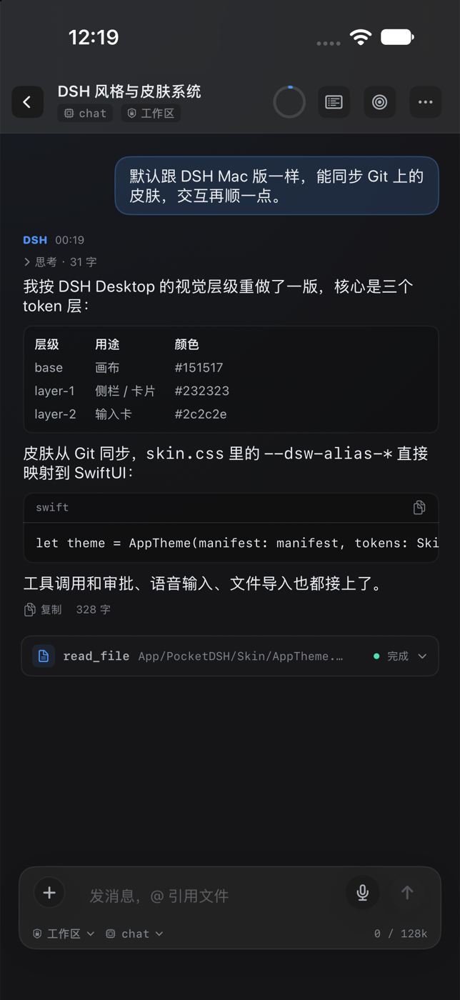
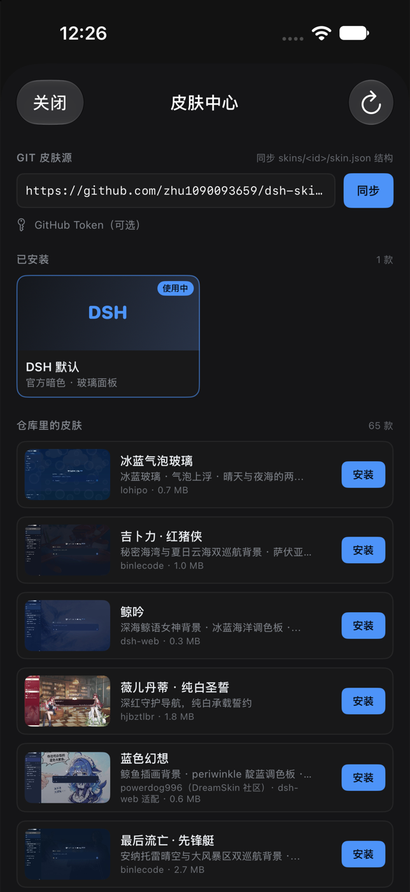
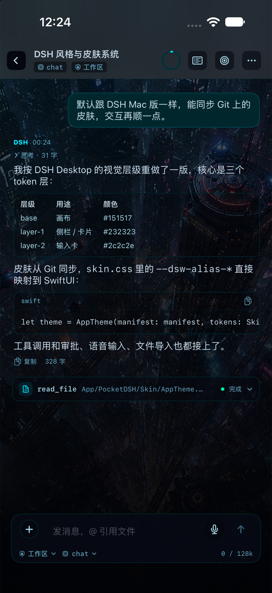

# DSH Pocket · iOS 版

> 把 [JopenChen/dsh-go](https://github.com/JopenChen/dsh-go) 的 DeepSeek Harness Agent 内核，用 Swift 6 重写为 **iPhone / iPad 原生 App**。
>
> 不是套壳、不是 WebView：事件溯源、Turn/Step 双循环、DeepSeek SSE、工具流水线、审批、Goal/Todo、JSONL 持久化全部在设备本地运行。

<p align="center">
  <b>DSHKit</b> · 纯 Swift 内核 &nbsp;|&nbsp; <b>PocketDSH</b> · iOS 17+ SwiftUI App
</p>

---

## 当前状态

| 部件 | 状态 | 验证 |
|---|---|---|
| `DSHKit` 核心包 | ✅ 完成 | `swift build` 通过（Swift 6.4.2） |
| 单元测试 | ✅ 40 个全通过 | `swift test`，0 failures |
| `PocketDSH` iOS App | ✅ 编译 + 模拟器运行 | Xcode 27.2 / iPhone 18 Pro · iOS 27.2 |
| 界面 / 皮肤系统 | ✅ DSH 桌面版默认风格 + v2 皮肤 | 65 款仓库皮肤同步 + 18 个本地皮肤解析验证 |
| `.ipa` 安装包 | ⏳ 需开发者账号签名 | 见 [App/README.md](App/README.md) |

> 核心包 40 个测试在 macOS 上通过；App 已在 Xcode 27.2 + iPhone 18 Pro 模拟器（iOS 27.2）里编译并运行。

## 界面预览



> 模拟器实拍（iPhone 18 Pro / iOS 27.2）。
>
>  

### 界面与皮肤

默认外观直接对齐 **DSH Desktop 暗色主题**：同一套 `--dsw-alias-*` token、同一个侧栏/输入卡层级。
皮肤中心支持 DSH Skin Manifest v2，可从 Git 仓库同步 `skins/<id>/skin.json`：

- 默认源：`https://github.com/zhu1090093659/dsh-skins`
- 设置 → 外观 → 皮肤中心 → 同步 → 安装 → 立即生效
- 也支持把皮肤目录拖进「文件」App 的 `DSH/Skins/`
- `patches.css` 与 `hooks.mjs` 不执行；视频背景降级为预览图

详见 [皮肤系统](docs/SKINS.md)。

---

## 这是什么

`dsh-go` 是一份纯 Go、进程内的 DeepSeek Harness 参考实现，逐词对译了官方 DSH 的能力接缝：事件溯源、Turn/Step、Goal、工具治理、错误分类。

本项目做三件事：

1. **逆向**：梳理 56 种事件、状态机、JSONL 布局、SSE 协议、工具流水线，写成 [逆向报告](docs/REVERSE_ENGINEERING.md) 与 [事件表](docs/EVENT_SCHEMA.md)；
2. **重写**：用 Swift actor 实现 `DSHKit`，事件 JSON 与 dsh-go 同构，可读写同一份 `sessions/<id>/{header.json,events.jsonl}`；
3. **做成 iOS App**：补上参考实现省略的工具 schema、tool_calls 聚合、tool 结果回填，并适配 iOS 沙箱、Files、Keychain、后台挂起。

### 与 dsh-go 的关系

| | dsh-go | DSH Pocket iOS |
|---|---|---|
| 定位 | Go 参考实现 / 学习素材 | iPhone / iPad 可运行产品 |
| 事件词汇表 | 56 种 | 56 种，字符串与字段一致 |
| 会话文件 | `header.json` + `events.jsonl` | 同布局、同 JSON 形状 |
| 工具调用 | 四级流水线 | 同语义 + 审批闸门 + 输出截断/spill |
| 模型流 | DeepSeek SSE | 同协议，修复 tool_calls 增量聚合 |
| 平台能力 | shell / 子进程 / jobs | iOS 不提供 shell（系统禁止） |

详见 [兼容性与差异](docs/PARITY.md)。

---

## 目录

```
apple-dsh/
├── Package.swift                 # SwiftPM：DSHKit（+ 开发用 dsh CLI、测试）
├── Sources/
│   ├── DSHKit/                   # 纯 Swift 内核（无 SwiftUI 依赖）
│   │   ├── Session/              # 事件、日志、不变量、fold、JSONL 持久化
│   │   ├── LLM/                  # DeepSeek SSE、错误分类、usage
│   │   ├── Tools/                # 工具协议、沙箱、内置工具
│   │   ├── Agent/                # Turn/Step 循环、审批、上下文组装
│   │   ├── Prompt/               # system prompt
│   │   └── Config/               # 配置与凭证接缝
│   └── dsh/                      # 开发期验证 CLI（不随 iOS App 发布）
├── App/
│   ├── project.yml               # XcodeGen：单一 iOS target
│   └── PocketDSH/                # iOS SwiftUI 源码
│       ├── Skin/                 # 主题 token、皮肤解析/仓库/管理
│       └── SkinCenterView.swift  # 皮肤中心
├── Tests/DSHKitTests/            # 40 个 XCTest
├── docs/                         # 逆向、架构、兼容性、事件表、测试
└── scripts/                      # mock DeepSeek 服务端与验证脚本
```

---

## 快速开始（iOS）

前置：macOS 14+、Xcode 16+、[XcodeGen](https://github.com/yonaskolb/XcodeGen)。

```bash
brew install xcodegen
cd App
xcodegen generate
open PocketDSH.xcodeproj
```

1. 选择 `PocketDSH` scheme；
2. Target → Signing & Capabilities → 选择你的 Team（bundle id 可改）；
3. 选 iPhone 模拟器或真机，Run。

首次启动：

1. 点右上角齿轮 → Settings；
2. 填入 DeepSeek API Key（存 Keychain）；
3. 选择模型（默认 `deepseek-chat`，可改 `deepseek-reasoner` 或自定义 base URL）；
4. 选择权限预设（safe / review / default / danger）。

### 工作区与文件

```
<App 容器>/Documents/DSH/Workspace     ← 文件读写都限制在这里
<App 容器>/Documents/DSH/sessions/<id>/{header.json,events.jsonl}
```

`UIFileSharingEnabled` 已开启：在系统「文件」App →「我的 iPhone / iPad」→「DSH Pocket」中
可以直接查看工作区、导入代码文件。Agent 的 `read_file / write_file / edit_file / glob / grep`
都被 `SandboxGuard` 限制在这个目录内。

### 安装到真机 / 导出 ipa

Xcode 选择你的开发团队与真机，Run 即可安装。需要分发时：

```bash
xcodebuild -project App/PocketDSH.xcodeproj \
  -scheme PocketDSH \
  -configuration Release \
  -destination 'generic/platform=iOS' \
  -archivePath build/PocketDSH.xcarchive archive
```

再用 Xcode Organizer 导出 Ad Hoc / Development ipa。签名、证书与设备 UDID 需自行配置。

---

## 开发期验证（可选，不属于 iOS App）

```bash
cd apple-dsh
swift test
```

无 API Key 的端到端验证（mock DeepSeek SSE → 工具调用 → 结果回填）：

```bash
node scripts/mock-deepseek.mjs 18081 &
DEEPSEEK_API_KEY=test swift run dsh run "read hello.txt" \
  -C /tmp/dsh-smoke --base-url http://127.0.0.1:18081 --preset danger \
  --root /tmp/dsh-sessions
```

完整记录见 [docs/TESTING.md](docs/TESTING.md)。`dsh` 只是开发验证工具，不参与 iOS App 构建。

---

## iOS 设计要点

- **没有 shell**：iOS 禁止 `fork/exec`，`ShellTool` 在编译期被 `#if os(macOS)` 排除；联网用 `web_fetch`，文件用沙箱工具。
- **工作区可审计**：所有路径经过标准化 + 符号链接解析 + 前缀校验，`../` 逃逸会被拒绝。
- **审批是一等能力**：写盘、联网等危险工具按预设决定 allow / ask / deny；无 UI 处理器时 fail-closed。
- **交互细节**：会话置顶/搜索/重命名、审批「总是允许」、全文复制与 Markdown 导出、触感反馈、紧凑模式返回。
- **移动端增强**：语音输入（Speech）、文件导入到工作区、Markdown 表格渲染、代码块横向滚动与复制。
- **Keychain**：API Key 不落 UserDefaults；App 卸载即清除。
- **后台挂起**：事件逐条落盘；恢复时 `repairOrphanTurn` 自动补齐未闭合的 turn/step/tool。
- **纯本地**：除 DeepSeek API、皮肤 Git 源与你显式让模型抓取的网页外，不上传任何数据。
- **皮肤可换但不执行代码**：只读 CSS token 与静态资源，`hooks.mjs`/`patches.css` 不运行。

---

## 已知边界

- 未实现 MCP、子代理、Workflow、Jobs、Skills 六层 Provider、SQLite 后端、OTel；矩阵见 [PARITY.md](docs/PARITY.md)。
- 自动 compaction 只做请求级裁剪；`surface/replace` 事件与 fold 已实现但未自动触发。
- 未做图片输入、语音输入、分享扩展、Widget。
- 皮肤的视频背景降级为静态预览图；`patches.css` 的选择器级改造不执行。
- 长任务切后台可能被系统挂起，回前台继续；事件不丢。

---

## 安装与签名

仓库**不包含已签名的 ipa**。每个安装者用自己的 Apple ID 在本地签名：

- Xcode + 免费 Apple ID：装到自己 iPhone，证书 7 天，到期重跑；
- 未签名 ipa + AltStore / Sideloadly：本机签名，同样 7 天；
- TestFlight / App Store：需要付费开发者账号。

```bash
./scripts/build-unsigned-ipa.sh   # 产出 build/PocketDSH-unsigned.ipa
```

详见 [安装到自己 iPhone](docs/INSTALL.md)。

## 隐私

没有遥测、没有账号系统、没有云端会话。API Key 只在本机 Keychain，会话与工作区只在本机沙箱；
只有 DeepSeek API、用户主动触发的网页抓取、皮肤 Git 源会产生网络请求。仓库不含证书、密钥或作者个人信息。

## 许可证与致谢

- 本移植遵循 MIT。原项目：`dsh-go` © 2026 JopenChen，MIT License。
- 语义参考：DeepSeek Harness（官方 TS 实现）。
- 与 DeepSeek 官方无隶属关系。

见 [LICENSE](LICENSE) 与 [NOTICE](NOTICE)。
