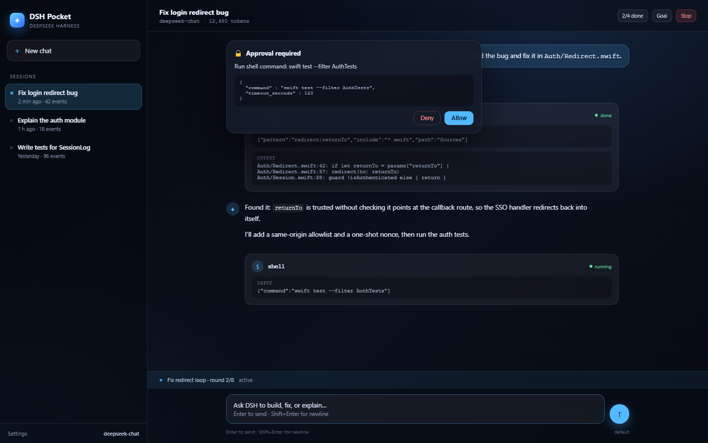

# DSH Pocket · 苹果版 dsh-go

> 把 [JopenChen/dsh-go](https://github.com/JopenChen/dsh-go) 的 DeepSeek Harness Agent 内核，用 Swift 6 原生重写为可在 iPhone / iPad / Mac 上运行的版本。
>
> **不是套壳、不是 WebView、不是远程桌面**：事件溯源、Turn/Step 双循环、DeepSeek SSE、工具流水线、审批、Goal/Todo、JSONL 持久化全部在设备本地运行。

<p align="center">
  <b>DSHKit</b> · 纯 Swift 内核 &nbsp;|&nbsp; <b>PocketDSH</b> · SwiftUI 多平台 App &nbsp;|&nbsp; <b>dsh</b> · 命令行
</p>

---

## 当前状态

| 部件 | 状态 | 验证 |
|---|---|---|
| `DSHKit` 核心包 | ✅ 完成 | `swift build` 通过（Swift 6.4.2） |
| 单元测试 | ✅ 40 个全通过 | `swift test`，0 failures |
| `dsh` CLI | ✅ 完成 | 对本地 mock SSE 服务端跑通「工具调用 → 结果回填 → 最终回答」 |
| SwiftUI App | ✅ 源码 + XcodeGen 工程 | 语法解析通过；需在 macOS + Xcode 16 上编译（本机为 Windows，无 SwiftUI 工具链） |
| iOS / macOS 安装包 | ⏳ 需在你的 Mac 上 `xcodebuild` | 见 [App/README.md](App/README.md) |

> 说明：本仓库在 Windows 上完成核心开发与验证；SwiftUI 只能在 Apple 平台编译，
> 因此 App 层交付的是**完整源码 + XcodeGen 工程描述**，在 Mac 上一条命令生成 `.xcodeproj`。

## 界面预览



> 这是按 SwiftUI 信息架构绘制的 HTML 设计稿（`docs/preview.html`），
> 用于在没有 Mac 的环境里预览布局；真机界面与交互以 `App/PocketDSH/` 源码为准。

---

## 这是什么

`dsh-go` 是一份纯 Go、进程内的 DeepSeek Harness 参考实现，价值在于「逐词对译」了官方 DSH 的能力接缝：事件溯源会话、Turn/Step 双循环、Goal 规划、工具治理、稳定错误分类。

本项目做三件事：

1. **逆向**：把 `dsh-go` 的 56 种事件、状态机、JSONL 布局、SSE 协议、工具流水线完整梳理成 [逆向报告](docs/REVERSE_ENGINEERING.md) 与 [事件表](docs/EVENT_SCHEMA.md)；
2. **重写**：用 Swift 6 actor 模型实现 `DSHKit`，事件 JSON 与 dsh-go **同构**，可直接读写同一份 `sessions/<id>/{header.json,events.jsonl}`；
3. **产品化**：补上参考实现刻意省略的部分（工具 schema、assistant tool_calls/tool 消息回填、流式 tool_calls 聚合），并做成 iPhone / iPad / Mac 上的原生 App。

### 与 dsh-go 的关系

| | dsh-go | DSH Pocket |
|---|---|---|
| 定位 | Go 参考实现 / 学习素材 | Apple 端可运行产品 + Swift 参考实现 |
| 事件词汇表 | 56 种 | 56 种，字符串与字段一致 |
| 会话文件 | `header.json` + `events.jsonl` | 同布局、同 JSON 形状 |
| 工具调用 | 四级流水线（pre/execute/post/result） | 同语义，另加审批闸门与输出截断/spill |
| 模型流 | DeepSeek SSE | 同协议，修复 tool_calls 增量聚合 |
| 平台能力 | shell / 子进程 / jobs | macOS 保留 shell；iOS 按系统限制移除 |

详见 [兼容性与差异](docs/PARITY.md)。

---

## 目录

```
apple-dsh/
├── Package.swift                 # SwiftPM：DSHKit + dsh CLI + 测试
├── Sources/
│   ├── DSHKit/                   # 纯 Swift 内核（无 SwiftUI 依赖）
│   │   ├── Session/              # 事件、日志、不变量、fold、JSONL 持久化
│   │   ├── LLM/                  # DeepSeek SSE、错误分类、usage
│   │   ├── Tools/                # 工具协议、沙箱、内置工具
│   │   ├── Agent/                # Turn/Step 循环、审批、上下文组装
│   │   ├── Prompt/               # system prompt
│   │   └── Config/               # 配置与凭证接缝
│   └── dsh/                      # 命令行（macOS / Windows 均可跑）
├── App/
│   ├── project.yml               # XcodeGen：iOS + macOS 两个 target
│   └── PocketDSH/                # SwiftUI 源码
├── Tests/DSHKitTests/            # 40 个 XCTest
├── docs/                         # 逆向、架构、兼容性、事件表、测试
└── scripts/                      # mock DeepSeek 服务端与冒烟脚本
```

---

## 快速开始

### 1. 核心包与测试（macOS）

```bash
cd apple-dsh
swift test
```

要求 Swift 6.0+、Xcode 16+（`DSHKit` 使用 iOS 17 / macOS 14 API）。

### 2. iPhone / iPad / Mac App

```bash
brew install xcodegen
cd App
xcodegen generate
open PocketDSH.xcodeproj
```

在 Xcode 中选择 `PocketDSH-iOS` 或 `PocketDSH-macOS`，设置你的 Development Team，Run。

首次启动进入 **Settings** 填入 DeepSeek API Key（存 Keychain），即可开始对话。
iOS 端工作区固定在 App 的 `Application Support/DSH/Workspace`；macOS 端同一路径，且默认启用 shell 工具。

详见 [App/README.md](App/README.md)。

### 3. 命令行

```bash
export DEEPSEEK_API_KEY=sk-...
swift run dsh run "读一下 hello.txt 并总结" -C /path/to/workspace
swift run dsh chat
swift run dsh sessions
swift run dsh replay <session-id>
```

参数：`--model`、`--base-url`、`--preset safe|review|default|danger`、`--root`、`--session`。

### 4. 无 API Key 的端到端验证

```bash
node scripts/mock-deepseek.mjs 18081 &
DEEPSEEK_API_KEY=test swift run dsh run "read hello.txt" \
  -C /tmp/dsh-smoke --base-url http://127.0.0.1:18081 --preset danger \
  --root /tmp/dsh-sessions
```

会看到 mock 服务端先返回 `read_file` 工具调用，CLI 执行后把结果回填，再拿到最终回答。
完整记录见 [docs/TESTING.md](docs/TESTING.md)。

---

## 设计要点

- **事件溯源是第一公民**：UI 不直接改状态，只读 `SessionProjection`；任何时刻重放 `events.jsonl` 都能恢复会话。
- **严格配对不变量**：`turn` 开闭、`step` 配对、`tool/call ↔ tool/result` 在 append 时校验，违规立即拒绝且不消耗 `seq`。
- **Apple 并发模型**：`SessionLog` / `SessionStore` / `Agent` 各为 actor；流式回调通过 `AsyncThrowingStream`；取消沿 Task 树传播到 URLSession。
- **审批是一等能力**：危险工具（写盘、shell、联网）按 `safe/review/default/danger` 预设决定 allow / ask / deny；无 UI 处理器时 fail-closed。
- **端侧限制诚实处理**：iOS 不注册 shell；`SandboxGuard` 把文件访问限制在工作区内；macOS 关闭 App Sandbox 才允许子进程，并在设置里明确提示。

---

## 已知边界

- 未实现 MCP、子代理、Workflow、Jobs、Skills 六层 Provider、SQLite 后端、OTel；接口位置在 [PARITY.md](docs/PARITY.md) 标注。
- Compaction 的 `surface/replace` 事件与 fold 已实现，但自动压缩阈值目前只做**请求级裁剪**，未自动写摘要事件。
- iOS 后台执行受系统限制：长任务切后台可能被挂起，回到前台会继续（事件已落盘）。
- 未做多模态附件（图片输入）。

---

## 许可证与致谢

- 本移植遵循 MIT。原项目：`dsh-go` © 2026 JopenChen，MIT License。
- 语义参考：DeepSeek Harness（官方 TS 实现）。
- 本项目与 DeepSeek 官方无隶属关系，「DeepSeek」「DSH」为其各自权利人的商标。

见 [LICENSE](LICENSE) 与 [NOTICE](NOTICE)。

